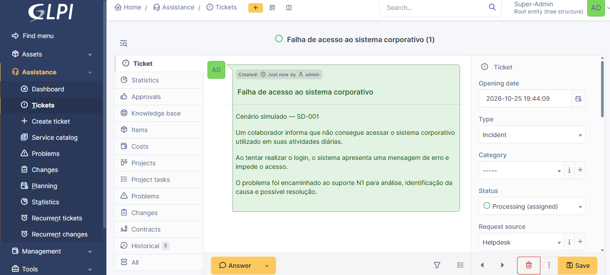
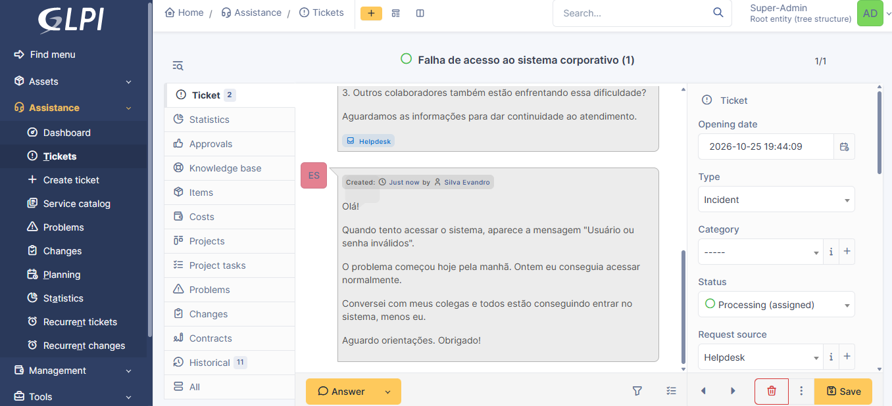
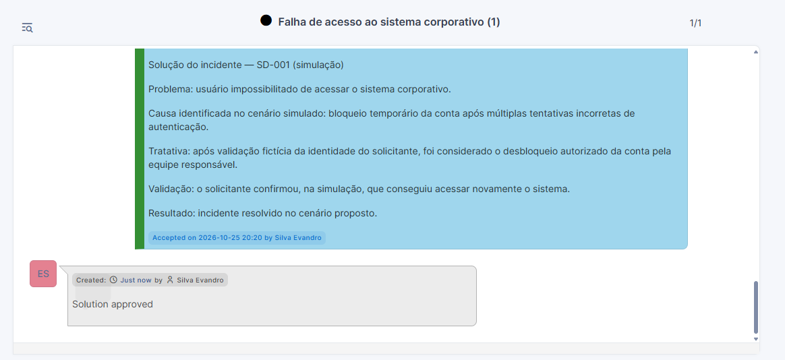

# SD-001 — Atendimento e resolução de incidente N1

**Status:** concluído no laboratório (simulação)  
**Ferramenta utilizada:** GLPI 11 — ambiente de testes em nuvem  
**Ticket no GLPI:** #1 — Falha de acesso ao sistema corporativo  
**Data do exercício:** 25/10/2026  
**Natureza:** atendimento simulado, executado em uma ferramenta real de gestão de chamados

## 1. Objetivo

Praticar o ciclo de um atendimento de primeiro nível (N1): registro, triagem, comunicação com o solicitante, análise de hipóteses, documentação da tratativa, proposta de solução e aprovação pelo solicitante.

## 2. Cenário

Um funcionário fictício informa que não consegue acessar um sistema corporativo. Ao longo da simulação, relata a mensagem **“Usuário ou senha inválidos”**, informa que o acesso funcionava no dia anterior e que os colegas conseguem acessar normalmente.

O sistema corporativo e seu mecanismo de autenticação **não foram implementados ou consultados**. Os resultados das verificações de autenticação e o desbloqueio da conta fazem parte do roteiro simulado.

## 3. Registro do chamado

| Campo | Informação |
| --- | --- |
| ID do laboratório | SD-001 |
| Ticket no GLPI | #1 |
| Título | Falha de acesso ao sistema corporativo |
| Tipo | Incident |
| Origem | Helpdesk |
| Urgência | Medium |
| Impacto | Medium |
| Prioridade | Medium |
| Solicitante | `usuario.teste` (perfil Self-Service; nome de exibição Evandro Silva) |
| Responsável | `admin` (usado como analista no laboratório) |
| Entidade | Root entity |
| Resultado | Solução aprovada pelo solicitante; tela final compatível com encerramento |

A classificação média foi adotada como ponto de partida didático. Em ambiente real, a prioridade deve seguir a matriz de impacto e urgência da organização.

## 4. Execução no GLPI

1. **Abertura:** criação do Ticket #1 com descrição do problema fictício.
2. **Contato inicial:** envio, pelo `admin`, de perguntas sobre mensagem de erro, início da falha e abrangência.
3. **Separação de papéis:** criação da conta `usuario.teste` com perfil Self-Service e associação dela como solicitante do ticket, mantendo `admin` como responsável.
4. **Resposta do solicitante:** acesso ao GLPI com `usuario.teste` e registro do relato de credenciais inválidas, início no mesmo dia e ausência de impacto nos colegas.
5. **Análise inicial:** registro das hipóteses de credenciais incorretas, conta bloqueada e senha expirada/alterada. Nesse momento, **não havia causa confirmada**.
6. **Resultado simulado da investigação:** roteiro estabeleceu bloqueio temporário por tentativas incorretas de autenticação.
7. **Tratativa simulada:** registro de validação fictícia da identidade e desbloqueio autorizado pela equipe responsável; nenhuma conta de sistema corporativo real foi desbloqueada.
8. **Validação simulada:** o solicitante respondeu, pelo GLPI, que voltou a acessar o sistema fictício.
9. **Solução:** registro formal da solução no GLPI.
10. **Aceite:** solução aprovada pela conta do solicitante. A tela exibiu **“Accepted on 2026-10-25 20:20”** e **“Solution approved”**.

## 5. Diagnóstico e solução documentados

**Sintoma:** mensagem “Usuário ou senha inválidos” ao tentar acessar a aplicação fictícia.

**Hipóteses consideradas:** erro de digitação, bloqueio temporário ou expiração/alteração de senha.

**Causa definida no roteiro simulado:** bloqueio temporário após múltiplas tentativas malsucedidas.

**Tratativa do roteiro:** verificação de identidade e desbloqueio por equipe autorizada.

**Validação:** confirmação fictícia do solicitante, registrada no histórico do GLPI, seguida de aprovação da solução.

> **Limite do exercício:** houve operação real do GLPI (criação de usuários, chamado, acompanhamentos, solução e aceite), mas não houve teste técnico de autenticação nem desbloqueio em um sistema corporativo real.

## 6. Evidências

As três capturas de tela foram publicadas na pasta [03-evidencias](../03-evidencias/).

### 6.1 — Chamado criado

Registro do Ticket #1 no GLPI 11, com título, descrição e classificação inicial.

### 6.2 — Interação com o solicitante

Histórico do chamado com comunicação entre a conta administrativa e o usuário fictício de perfil Self-Service.

### 6.3 — Solução aprovada

Solução registrada no GLPI e aceite do solicitante, com indicação **“Solution approved”**.

> As capturas comprovam as ações realizadas no **GLPI**; o problema de autenticação corporativa e o desbloqueio permaneceram simulados.

## 7. Aprendizados

- Registrar um incidente com informações úteis para triagem.
- Distinguir relato do solicitante, hipótese e diagnóstico confirmado.
- Trabalhar com perfis e papéis diferentes no GLPI.
- Registrar interações no histórico de um ticket.
- Separar registro de acompanhamento, registro de solução e aprovação pelo solicitante.
- Evitar solicitar senhas e respeitar processos de verificação de identidade.
- Documentar claramente o que foi **simulado** e o que foi **executado na ferramenta**.

## 8. Observação sobre permissões

A conta `admin` possui privilégios de **Super-Admin** e foi usada para representar o analista N1 apenas por simplicidade do laboratório. Isso **não reproduz o princípio do menor privilégio**; em um ambiente de produção, o atendimento deve ocorrer com um perfil técnico apropriado.
